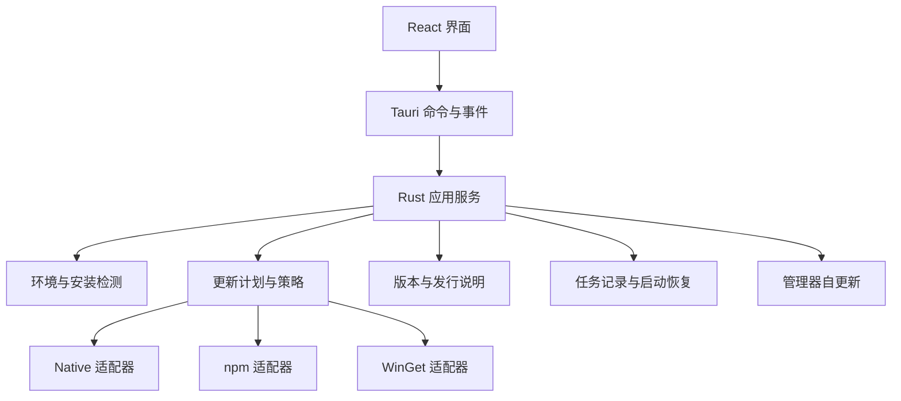
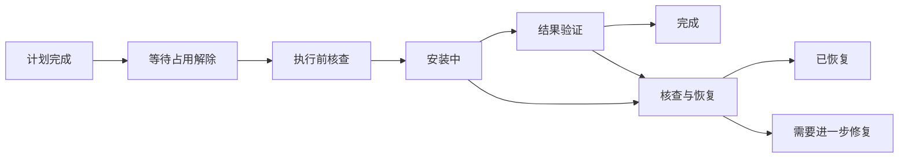

# Claude Code Manager 开源项目实施方案

方案版本 v1.0 · 编制日期 2026-11-16（太平洋时间）

## 1. 项目约定与交付目标

| 项目 | 约定 |
| --- | --- |
| 产品名称 | Claude Code Manager |
| GitHub 归属 | Yeyangchen |
| 仓库名称 | claude-code-manager |
| 目标远端地址 | https://github.com/Yeyangchen/claude-code-manager.git |
| 本地项目根目录 | `C:\FeiQunProjects\NewApp` |
| 项目形式 | 面向个人开发者的开源桌面工具 |
| 首发平台 | Windows x64 |
| 首发语言 | 简体中文，界面文案集中管理以便增加英文 |
| 技术选型 | Tauri 2、React、TypeScript、Vite、Rust |
| 建议许可证 | MIT，代码复用时保留对应上游版权和许可 |
| 管理器首个正式版本 | `v0.1.0` |
| 当前交付 | 完整方案、独立本地 Git 仓库及方案提交 |

账号、仓库名称、开源方向与项目路径由用户确认。平台、技术栈、许可证和功能分期为本方案的实施建议。远端地址为预定地址，远端创建、首次推送和仓库规则配置在 GitHub 账号授权可用后完成。

产品围绕 Claude Code CLI 的安装识别、版本更新、指定版本重装、更新策略和故障恢复展开。用户在一个界面里能够确定当前终端使用的版本、可安装版本、更新结果及故障原因。

首发交付应包含可下载的 Windows 安装包、公开源码、构建说明、版本记录和问题反馈入口。后续扩展 Windows ARM64、WSL、macOS 与 Linux。

## 2. 参考项目分析与复用策略

参考项目为 Wangnov/Codex-App-Manager。本次静态分析固定在 `82887d8799e70deb15bd3ed9b92d420d31378cea`，项目版本为 `0.5.17`。其主要技术结构为 React 界面、Tauri 命令桥、Rust 应用服务和平台安装引擎。[参考源码](https://github.com/Wangnov/Codex-App-Manager/tree/82887d8799e70deb15bd3ed9b92d420d31378cea)

| 能力 | 参考项目的实现 | 本项目的采用方式 |
| --- | --- | --- |
| 操作规划 | 检测当前安装后生成确定的安装或更新计划 | 保留流程，改为按安装实例和来源规划 |
| 任务互斥 | 文件锁、操作令牌和后端状态管理 | 借鉴并发控制与任务标识设计 |
| 前端恢复 | 界面重载后重新读取后端任务快照 | 采用相同交互原则 |
| 崩溃恢复 | 文件切换前持久化事务，启动时检查残留任务 | 改为适合外部安装器的操作记录和事实核查 |
| 安装归属 | 保存安装路径、版本和来源 | 扩展环境、包管理器前缀和 Shell 命中信息 |
| 网络与日志 | 代理设置、进度、诊断与错误分类 | 借鉴通用设计 |
| 管理器自更新 | Tauri updater、签名和发布元数据 | 使用本项目独立的密钥、地址与版本 |

参考项目已经实现后端任务快照、跨管理器进程锁和终态证据。其持久化文件回滚类型主要为 macOS 文件替换和 Windows portable 安装，Windows MSIX 的结果需要额外核实。本项目为每种安装来源分别声明恢复能力。[操作管理](https://github.com/Wangnov/Codex-App-Manager/blob/82887d8799e70deb15bd3ed9b92d420d31378cea/src-tauri/src/app/oplock.rs) · [事务恢复](https://github.com/Wangnov/Codex-App-Manager/blob/82887d8799e70deb15bd3ed9b92d420d31378cea/src-tauri/src/app/install_tx.rs)

实施时新建独立仓库，按需要提取或改写通用模块。Native、npm、WinGet 的安装模型与执行器单独设计。应用名称、图标、程序标识、安装目录、下载地址和更新公钥采用本项目的独立值。实际复制上游代码时，记录文件与来源提交，保留 MIT 声明。[上游许可证](https://github.com/Wangnov/Codex-App-Manager/blob/82887d8799e70deb15bd3ed9b92d420d31378cea/LICENSE)

## 3. 用户场景与首发范围

### 3.1 核心用户场景

1. 电脑尚未安装 Claude Code，用户通过管理器完成原生安装并验证终端可调用。
2. 已有安装需要升级，用户看到当前版本、目标版本与发行说明后发起更新。
3. 同时存在 Native、npm 或 WinGet 安装，用户需要知道终端实际使用哪一份。
4. 新版本出现兼容性问题，用户重装一个确认可获得的旧版本，并改为手动更新。
5. 更新因网络、权限或文件占用失败，用户看到当前安装是否可用及下一步修复动作。
6. 管理器界面关闭、重载或异常退出后，用户重新打开能够获知实际任务结果。

### 3.2 首发能力矩阵

| 能力 | Windows Native | Windows npm | Windows WinGet |
| --- | --- | --- | --- |
| 检测安装与版本 | 支持 | 支持，绑定 npm prefix | 支持，绑定包标识 |
| 识别终端命中路径 | 支持 | 支持 shim 解析 | 支持别名与实际路径核查 |
| 检查可用更新 | 支持 | 按 npm registry 查询 | 按 WinGet 来源查询 |
| 全新安装 | 首发主入口 | 后续按需增加 | 后续按需增加 |
| 升级已有安装 | 支持 | 支持 | 支持 |
| 指定版本重装 | 首发重点验证 | 后续增加版本可用性和降级测试 | 后续按来源能力增加 |
| 回退入口 | 重装已验证可获得的旧版本 | 首发提供明确修复说明 | 首发提供明确修复说明 |
| 更新策略展示 | 支持 | 支持适用配置的来源展示 | 支持包管理器更新策略展示 |
| 诊断与日志 | 支持 | 支持 | 支持 |

`v0.1.0` 完成上述首发承诺后发布。Native 指定版本重装和失败恢复优先在技术原型中验证，验收结果写入实际支持表。组织策略、环境变量或来源限制导致能力不可用时，界面展示原因及配置来源。

### 3.3 后续扩展

| 版本阶段 | 扩展方向 |
| --- | --- |
| v0.2 系列 | Windows ARM64、WSL 环境管理、npm 历史版本操作 |
| v0.3 系列 | macOS Native 与 Homebrew，完成对应签名和测试 |
| 后续迭代 | Linux Native 与系统包管理器、经验证的离线恢复、可选下载镜像 |

每个 WSL 发行版及用户拥有独立安装记录。VS Code 扩展私有 CLI、Claude Desktop 的相关命令别名在诊断中标明归属。扩展组件的升级交由其所属应用管理流程处理。[安装冲突说明](https://code.claude.com/docs/en/troubleshoot-install)

## 4. 界面与交互设计

### 4.1 页面结构

| 页面 | 内容与操作 |
| --- | --- |
| 概览 | 环境选择、实际生效版本、安装来源、目标版本、最近检查时间、安装或更新按钮 |
| 版本 | stable/latest、历史候选版本、发行说明、平台可用性、原生指定版本重装 |
| 环境 | 已发现安装集合、Shell 命中关系、PATH 问题、诊断结果、修复入口 |
| 设置 | 更新策略、网络代理、通知、管理器自身更新、数据位置 |
| 任务详情 | 当前阶段、真实进度、耗时、输出摘要、完成状态、重试与日志导出 |

桌面主窗口采用可调整大小的布局，左侧导航、右侧内容。默认浅色并支持跟随系统的深色模式，正文使用清晰的系统中文字体，路径、版本和命令使用等宽字体。所有关键操作提供键盘焦点和明确的文本反馈。

### 4.2 首次启动

1. 扫描系统、架构、常见安装位置及已存在的包管理器。
2. 检查 CMD、PowerShell 和可用的 Git Bash 命令解析情况。
3. 展示发现的安装，标记当前选择的 Shell 命中的实例。
4. 有一份明确安装时展示它的概览，多份安装时提供实例选择。
5. 发现冲突时给出具体路径、原因及可审阅的修复动作。
6. 完成第一次版本查询，记录检查时间和查询来源。

管理器进程继承的 PATH 与既有终端环境可能不同。界面必须标明检测使用的 Shell 和环境，说明新终端的验证结果。对于别名、函数和用户自定义启动脚本，提供显式诊断入口并展示发现的覆盖关系。

### 4.3 更新交互

更新前展示目标实例、当前版本、目标版本、安装来源、是否需要等待会话结束，以及恢复方式。点击更新后创建任务。出现文件占用时提供等待与重新检查。任务成功后展示安装结果和终端生效结果，PATH 问题可以独立修复与复核。

下载器能够获得字节数时显示百分比。外部安装器只输出阶段信息时，展示阶段、运行时间和最新有效输出。任务结束依赖重新检测结果。

## 5. 技术架构与领域模型

### 5.1 结构



前端负责展示与交互。Rust 负责进程执行、文件访问、网络请求、计划校验和任务持久化。前端提交安装实例 ID 与用户选择，后端从已检测记录中解析实际执行路径和操作参数。

采用单个 Rust 应用工程和明确模块划分，出现稳定的复用需求后再提取独立 crate。依赖版本在搭建阶段选择兼容的稳定版，并提交 lockfile。

### 5.2 核心模型

| 模型 | 核心字段 |
| --- | --- |
| Environment | ID、操作系统、架构、用户上下文、Shell、WSL 发行版、配置目录 |
| Installation | ID、环境 ID、来源、启动路径、解析后路径、版本、包管理器前缀、归属证据 |
| ShellResolution | 环境、Shell、命中路径、候选路径、别名或函数、检测时间 |
| ProviderCapabilities | 可安装、可升级、可指定版本、可恢复、可修改策略及限制原因 |
| Release | 版本、平台、来源、产物、可用性、摘要或签名信息、发行说明 |
| UpdatePlan | 实例 ID、预期当前状态、精确目标、执行步骤、占用情况、恢复能力 |
| Operation | ID、计划、阶段、开始时间、退出码、诊断、验证结果、恢复状态 |
| PolicyState | 策略目标、生效配置、来源层级、作用范围、覆盖原因 |

计划中的当前状态包含版本、路径、来源、文件标识或摘要及包管理器记录。执行前重新读取并比较，发生外部变更时重新生成计划。

### 5.3 适配器职责

Native、npm、WinGet 分别提供检测、查询、规划、执行、验证与能力声明。实际公共接口在原型验证后确定。

- Native 处理官方原生安装器及已有原生 CLI 的调用。
- npm 绑定检测到的 npm 可执行路径、Node 环境和 prefix，并核对包归属。
- WinGet 绑定 `Anthropic.ClaudeCode` 和已确认来源，查询、升级及验证使用同一来源。
- 后续 Homebrew 适配器记录具体 cask，WSL 适配器记录发行版及用户上下文。

原生 CLI 提供 `claude install [version]`、`claude update`、`claude --version` 和诊断入口。指定版本使用位置参数。实现针对已检测版本选择可用命令，对旧版输出保留兼容解析和原始诊断。[官方 CLI 参考](https://code.claude.com/docs/en/cli-reference)

## 6. 更新、回退与异常恢复

### 6.1 执行流程

1. 获取目标安装实例的管理器操作锁，并核对共享配置资源是否被其他任务修改。
2. 重新检测路径、版本、来源、可用目标版本和运行中进程。
3. 生成固定目标版本的计划，将操作前状态与任务 ID 持久化。
4. 需要改变更新策略时，按字段记录原值并合并写入，检查实际生效情况。
5. 调用对应来源的执行器，采集输出、退出码和阶段信息。
6. 安装后使用目标可执行文件的绝对路径验证版本。
7. 重新核查目标 Shell 的命中路径，执行适用的安装诊断。
8. 记录终态并释放锁，展示安装结果、终端生效情况和恢复入口。

已有原生安装采用固定目标版本安装。新装或当前可执行文件损坏时采用官方 bootstrap 路径。具体参数和 bootstrap 下载行为由版本适配模块封装。npm 升级绑定具体包版本与 prefix，WinGet 目标版本在来源查询与执行时复核。

管理器操作锁协调本工具发起的任务。官方后台更新、用户手动运行的安装器和其他包管理工具可能独立运行，执行前后都需要进行状态核查。运行中会话采用延后执行策略，关键安装阶段持续展示状态。

### 6.2 任务状态



等待阶段可取消。下载及安装阶段的取消行为按执行器能力定义，关闭界面和取消底层任务分别处理。外部进程发生超时后先确认其存活状态及实际安装状态，再决定重试。

### 6.3 终态与重试

| 结果 | 用户反馈 | 后续动作 |
| --- | --- | --- |
| 安装完成且终端生效 | 展示新版本及命中路径 | 正常结束 |
| 安装完成但终端命中其他实例 | 展示新安装与实际命中项 | 独立处理 PATH 或实例选择 |
| 操作失败且原安装可用 | 展示失败原因与原版本 | 允许重新查询并重试 |
| 已恢复到旧版本 | 展示恢复版本及验证结果 | 记录恢复历史 |
| 状态尚需核实 | 展示已知事实和诊断结果 | 重新检测、修复或导出日志 |

Native 回退定义为通过官方安装入口重装选定旧版本，并按联网流程实现。回退完成后检查可执行版本和配置兼容性。历史版本目录可能被清理，旧文件存在时也要验证它是否可用于恢复。npm 和 WinGet 的降级能力在后续版本分别验证后开放。[安装及回退依据](https://code.claude.com/docs/en/setup#install-a-specific-version) · [Windows 更新故障恢复](https://code.claude.com/docs/en/troubleshoot-install#claude-exe-missing-after-an-update-on-windows)

### 6.4 异常退出后的处理

任务记录使用带 schema version 的结构化文件，写入采用临时文件和原子替换。启动时先读取未完成任务，核对关联进程、包管理器记录与实际版本，再决定完成记录、继续等待或进入恢复。日志包含操作 ID，便于关联界面和后台事件。

首次实现阶段采用 JSON 文件持久化配置与任务记录，并设置历史数量和保留期限。按实际查询需求决定后续是否引入 SQLite。

## 7. 更新策略、配置与数据

### 7.1 策略设计

| 策略 | 行为 |
| --- | --- |
| 跟随官方更新 | 展示该来源实际更新机制与当前通道 |
| 管理器提醒后手动更新 | 关闭适用的 Claude 后台更新，管理器检查并提醒 |
| 保持当前版本 | 使用手动更新策略，记录期望版本，检测到外部变化时提示 |

关闭后台更新使用适用配置中的 `DISABLE_AUTOUPDATER=1`。`DISABLE_UPDATES` 会同时限制手动安装入口，已有此类配置时需要展示来源和实际能力。策略切换后通过新进程诊断验证效果。[更新环境变量](https://code.claude.com/docs/en/env-vars)

保持当前版本通过更新策略与版本漂移检测实现。策略的作用范围按配置目录和来源识别，多个安装共享配置时展示共同影响范围。官方组织策略决定的限制在界面中标明。用户配置中的 `minimumVersion` 约束版本下限。[版本下限设置](https://code.claude.com/docs/en/settings-reference#minimumversion)

### 7.2 配置写入

- 读取用户实际配置目录，支持 `CLAUDE_CONFIG_DIR`。
- 写入前解析原文件，并检测读取后是否出现并发修改。
- 仅合并本次操作涉及的字段，保留未知字段。
- 保存管理器改动的原值，恢复时比较当前值，避免覆盖用户之后的修改。
- 展示用户、项目和组织设置的来源及覆盖关系。

Claude Code 配置具有不同作用域和优先级，管理器需要按具体配置项判断实际生效来源。[配置说明](https://code.claude.com/docs/en/settings)

### 7.3 数据存储与诊断

管理器使用 Tauri 提供的应用数据目录，按配置、任务、日志和缓存分别存储。运行日志默认脱敏用户名、凭据、代理认证信息和环境变量值。诊断导出前提供预览，导出内容以版本、路径关系、错误码和操作阶段为主。

首发采用本地状态存储。网络访问用于版本查询、官方安装来源、发行说明和管理器更新。README 中说明数据位置、缓存清理方式与网络访问用途。

## 8. 版本来源、网络与文件验证

### 8.1 版本目录

Native 通道查询读取官方 latest/stable 入口，各具体版本读取平台 manifest。历史候选版本结合官方 CHANGELOG 和本地安装记录产生，展示安装按钮前确认目标来源仍提供对应产物。查询结果记录时间、来源和缓存状态。[官方 latest 入口](https://downloads.claude.ai/claude-code-releases/latest) · [官方 stable 入口](https://downloads.claude.ai/claude-code-releases/stable) · [官方 CHANGELOG](https://github.com/anthropics/claude-code/blob/main/CHANGELOG.md)

Native 通道、npm registry 和 WinGet 来源分别查询。包管理器暂未提供目标版本时，界面显示该来源当前可安装的版本。首次运行、用户点击检查及管理器运行期间的定时检查共用请求去重与缓存。

建议后台检查间隔为 6 小时，失败使用退避重试。关闭管理器后停止其检查任务。开机启动和托盘常驻按用户设置启用。

### 8.2 网络设置

提供系统代理、直连、自定义代理三种模式。管理器 HTTP 客户端与安装子进程分别验证代理传递，显示实际采用的网络方式。代理设置以任务级环境或执行器参数传递，并按来源能力处理。

区分网络不可达、代理认证、证书问题、请求限流、目标不存在和文件验证失败。首发使用官方来源与 GitHub Releases。下载镜像按后续需求建设，需提供来源信息、缓存策略和签名验证。

### 8.3 文件验证

对于管理器自行下载或缓存的 Native 文件，验证平台、版本、manifest 与文件摘要，并验证可用的官方 manifest 签名及 Windows Authenticode 签名。签名验证实现与密钥更新策略在技术原型阶段验证。历史版本的验证能力在版本列表中标明。[官方完整性验证](https://code.claude.com/docs/en/setup#binary-integrity-and-code-signing)

进程调用使用明确的可执行路径与参数列表。版本参数执行格式和来源校验，路径参数执行归属与规范化检查。UI 只提交定义好的业务操作，Tauri 后端决定允许的执行器。

## 9. 项目目录与开源交付

以下为目标结构，目录随实际实现创建。

```text
NewApp/
├── PROJECT_PLAN.md
├── README.md
├── LICENSE
├── NOTICE
├── CONTRIBUTING.md
├── SECURITY.md
├── CHANGELOG.md
├── .gitignore
├── .github/
│   ├── ISSUE_TEMPLATE/
│   ├── pull_request_template.md
│   └── workflows/
│       ├── ci.yml
│       └── release.yml
├── src/
│   ├── app/
│   ├── features/
│   ├── services/
│   └── shared/
├── src-tauri/
│   ├── src/
│   │   ├── commands/
│   │   ├── domain/
│   │   ├── services/
│   │   ├── providers/
│   │   ├── platform/
│   │   └── storage/
│   └── tauri.conf.json
├── tests/fixtures/
├── scripts/
└── docs/
    ├── architecture.md
    ├── development.md
    ├── release.md
    ├── compatibility.md
    └── releases/
```

`NOTICE` 在实际复用第三方代码或资产时记录归属。README 提供能力矩阵、截图、安装入口、更新方式和常见故障。CONTRIBUTING 说明开发流程、检查命令与 PR 规范。SECURITY 提供适用的私密漏洞反馈渠道。测试 fixture 使用人工构造或脱敏数据。

应用品牌采用独立设计，README 标明项目维护者与参考来源。中文 README 作为首发主文档，英文简介随公开仓库提供。

## 10. Git 与 GitHub 管理

### 10.1 仓库初始化

本地根目录固定为 `C:\FeiQunProjects\NewApp`，默认分支为 `main`。建立首个方案提交，再按任务创建短期工作分支。远端命名为 `origin`，地址使用 `https://github.com/Yeyangchen/claude-code-manager.git`。

GitHub 建仓采用 Public，先检查同名仓库状态，存在时核实历史再关联。首次推送建立 `main` 上游关系，并核对远端提交与本地提交一致。远端创建和推送需要 Yeyangchen 账号的有效 GitHub 授权。

### 10.2 分支与提交

| 场景 | 分支示例 | 提交示例 |
| --- | --- | --- |
| 功能开发 | `feat/native-update` | `feat: add native update workflow` |
| 缺陷修复 | `fix/path-resolution` | `fix: resolve npm shim precedence` |
| 文档 | `docs/release-guide` | `docs: document release process` |
| 发布准备 | `release/v0.1.0` | `chore(release): prepare v0.1.0` |

提交遵循 Conventional Commits，一个提交聚焦一个可说明的变更。提交前检查 diff 和暂存区，显式选择文件，构建缓存、安装日志、个人配置和签名私钥由 `.gitignore` 排除。应用依赖 lockfile 随源码提交。

功能分支通过 PR 合入 `main`，默认 squash 合并并删除已合并分支。提交记录保留功能和修复的可追踪边界。紧急修复从当前主线或对应发布 tag 建分支，补齐适用验证后发布 patch 版本。

### 10.3 分支保护

为 `main` 设置 PR 合入、已启用 CI 必须通过、禁止 force push 和删除。单人维护阶段采用作者自检与 CI，必需外部审批数设为 0，后续多人协作时调整。必需检查名称与真实工作流 job 对应，首次工作流成功运行后启用要求。[GitHub 分支保护](https://docs.github.com/en/repositories/configuring-branches-and-merges-in-your-repository/managing-protected-branches/about-protected-branches)

Issue 使用 bug、feature、documentation 等标签，并按里程碑关联。PR 正文写清问题、结果、验证与兼容性影响。仓库设置、远端地址和版本规则纳入发布文档，维护者能够复现。

## 11. CI/CD 与开源发布

### 11.1 PR 和主分支检查

| 检查 | 内容 |
| --- | --- |
| Frontend | 依赖安装、TypeScript、lint、相关测试、生产构建 |
| Rust | rustfmt、Clippy、领域和适配器测试 |
| Windows build | Windows x64 编译与安装包构建 |
| Documentation | 文档结构、链接及版本号一致性检查 |

安装器会修改系统状态的端到端验收在一次性虚拟机或隔离账户进行。常规 CI 使用固定的脱敏 fixture、模拟执行器和临时目录，覆盖解析、计划、配置合并及恢复判断。具体测试优先针对版本识别、错误目标和恢复回归。

PR 工作流采用只读仓库权限。发布任务按需获得写 Release 的权限，签名秘密仅传入对应步骤。第三方 Action 固定到经过核验的 commit，并记录升级方式。来自 fork 的 PR 通过公开依赖和测试 fixture 完成检查。[GitHub Actions 安全使用](https://docs.github.com/en/actions/reference/security/secure-use)

### 11.2 版本策略

管理器使用独立 SemVer，例为 `0.1.0`、`0.1.1` 和 `0.2.0`。预发布使用 `0.1.0-beta.1`。Git tag 使用对应的 `v` 前缀，目标 Claude Code 版本作为安装数据单独存储。

发布准备统一更新前端、Tauri、Rust 包版本及对应 lockfile 项，检查一致性后提交。发布说明与版本提交同时合入。通过确定的 tag 触发发布，发布后修复使用新版本号和新 tag。

### 11.3 发布流程

1. 在 release PR 中确认功能范围、兼容性表、版本号和发行说明。
2. 通过 CI 与该版本适用的隔离环境验收。
3. 合并后在对应 commit 上创建版本 tag。
4. 工作流从 tag 构建 Windows 安装包。
5. 按当前已配置能力执行 Windows 代码签名，再生成 Tauri updater 签名。
6. 生成 SHA256SUMS，核验产物、版本、签名和下载地址对应关系。
7. 将完整产物上传到 GitHub Draft Release，验证下载后发布。
8. 完整稳定版可用后更新稳定通道元数据，预发布使用独立通道。
9. 检查 Release 下载与管理器更新路径，记录发布验收结果。

上传或发布失败可按同一 tag 核验已有草稿并续传，避免重复生成互相不一致的产物。稳定版更新元数据只指向已经可下载且验证通过的完整发布。

### 11.4 发布产物与签名

首发 Release 包含带版本、系统、架构的安装包、updater 所需工件和签名、更新元数据、SHA256SUMS 及发行说明。示例安装包名称为 `ClaudeCodeManager_0.1.0_windows_x64-setup.exe`，实际名称与打包器配置保持一致。

Tauri updater 使用本项目的独立密钥对，公钥随客户端发布，私钥通过受控 CI secret 使用。密钥建立后保存可恢复的备份与轮换记录。首发前验证从测试旧版到新版的完整更新路径，应用版本与通道选择均需验证。[Tauri updater](https://v2.tauri.app/plugin/updater/)

Windows Authenticode 与 updater 签名分别配置和验收。项目可先发布明确标注代码签名状态的预览版，证书成本和账号配置另行安排。稳定版发布说明准确反映签名状态，updater 公钥与私钥配置完成后再开放管理器内自动安装更新。

### 11.5 运维成本

首发使用 GitHub 仓库、Actions 和 Releases。构建额度、产物存储及发布限制按实际账户与平台规则核对。主要可选成本为 Windows 代码签名、后续 macOS 开发者账号，以及镜像或官网服务。MVP 的版本管理能力通过本地逻辑和官方元数据实现。

## 12. 里程碑与工作量

以下按一名熟悉 Tauri/Rust 的开发者全职投入估算，开源发布版约 18–25 个工作日。账号授权、证书开通和外部审核等待时间另计。原型发现的兼容性问题可能调整后续任务顺序。

| 里程碑 | 时间 | 交付 | 完成条件 |
| --- | --- | --- | --- |
| M0 方案与仓库 | 0.5–1 天 | 方案、Git、GitHub 归属、任务分解 | 方案落盘，本地提交可追踪，远端具备权限时推送 |
| M1 技术原型 | 2–3 天 | Native 安装/降级验证、多安装检测样例 | 核实安装命令、策略范围、代理和版本验证 |
| M2 应用骨架 | 2–3 天 | Tauri/React、页面框架、IPC、存储、CI | 窗口可运行，检查和构建通过 |
| M3 Native 闭环 | 4–5 天 | 新装、升级、指定版本、状态与恢复 | 在隔离环境通过核心成功和失败场景 |
| M4 来源与诊断 | 3–4 天 | npm/WinGet 升级、PATH、策略、日志 | 多安装目标选择正确，错误可解释 |
| M5 发布准备 | 3–4 天 | 开源文档、安装包、自更新、发布工作流 | 测试 Release 下载和管理器更新通过 |
| M6 公测与修复 | 3–5 天 | beta 验收、缺陷修复、v0.1.0 | 首发矩阵全部通过，已知限制有对应说明 |

M1 的验证记录进入 `docs/compatibility.md`。若某来源能力受上游限制，先修正公开能力表和界面，再调整里程碑。能够完成的独立模块继续推进。

## 13. 测试与验收清单

| 编号 | 场景 | 通过标准 |
| --- | --- | --- |
| A01 | 干净 Windows 用户环境 | 安装后目标路径和新终端均可正确报告版本 |
| A02 | 单个 Native 安装 | 版本、路径、通道和更新目标识别正确 |
| A03 | Native/npm/WinGet 并存 | 每个实例归属明确，选定目标操作准确 |
| A04 | npm 不同 prefix 或 Node 环境 | 计划和执行绑定同一 npm 环境 |
| A05 | Shell 别名和 PATH 顺序冲突 | 显示命中关系，修复后重新验证 |
| A06 | 原生指定版本重装 | 目标可获得，重装后精确版本一致 |
| A07 | stable/latest 与策略覆盖 | 显示实际策略、来源和可能的降级目标 |
| A08 | 多实例共享配置 | 写入范围正确，并发修改可识别 |
| A09 | 网络中断或代理失败 | 错误分类正确，重新检查后可重试 |
| A10 | 安装器非零退出或超时 | 核实实际安装与进程状态，终态准确 |
| A11 | 运行中 Claude 会话 | 延后执行与文件占用处理符合来源能力 |
| A12 | 两个管理器同时操作 | 相同安装或共享资源互斥 |
| A13 | 外部工具改变版本 | 旧计划失效，重新检测后生成新计划 |
| A14 | 前端重载 | 从后端恢复同一任务状态 |
| A15 | 管理器异常退出 | 启动后按任务记录核实实际结果 |
| A16 | 中文、空格和较长路径 | 路径解析及子进程参数正确 |
| A17 | 目标文件或元数据校验失败 | 拒绝使用该产物并解释来源 |
| A18 | 日志与诊断导出 | 凭据与个人信息脱敏，导出前可预览 |
| A19 | 安装成功但 PATH 仍命中旧版 | 安装和终端结果分别展示，修复可独立重试 |
| A20 | 管理器自身升级 | 旧版可验证并安装新版，签名错误可识别 |
| A21 | GitHub 发布中断与重跑 | 同一 tag 的产物一致，稳定元数据可用 |

构建通过、实际安装成功和模型请求可用分别验证。安装健康检查以版本、命令解析和只读诊断为基础，避免把模型网络或账户状态混入安装结果。

## 14. 技术不确定性与处理方式

| 项目 | 影响 | 处理方式 |
| --- | --- | --- |
| 官方安装器与分发格式变化 | 版本查询或安装适配失效 | 封装来源适配器，保存 fixture，提供可解释错误 |
| 历史版本撤下或签名能力不同 | 部分目标无法重装 | 安装前核实产物和验证能力 |
| Windows 占用与进程并发 | 安装被阻止或结果变化 | 等待会话结束，执行前后复核 |
| 外部安装器部分成功 | 退出码与实际状态可能不同 | 持久化操作记录并重新检测 |
| 配置或会话格式跨版本兼容 | 旧版启动或读取失败 | 原型验证已选版本组合，回退后诊断 |
| GitHub 访问与限流 | 更新检查延迟 | 缓存、退避、手动重试和来源状态展示 |
| 管理器签名密钥遗失 | 自更新连续性受影响 | 首次发版前落实备份和恢复流程 |
| 单人维护资源 | 并行平台扩展拉长周期 | 按已承诺能力矩阵推进和验收 |

原项目运行表现、Claude Code 实机安装/降级路径、旧版 doctor 输出及 Windows 代理传递属于实现前的验证项。当前方案依据静态源码、官方文档及发布元数据制定。

## 15. 开始实施时的事项

- GitHub 账号和仓库名称已确定为 `Yeyangchen/claude-code-manager`。
- 完成 GitHub 授权后创建或关联公开远端，推送本地提交并核对远端历史。
- 按本方案建立首发 Issue 与里程碑，先执行 M1 技术原型。
- 在原型结果基础上固定实际适配器参数、能力表和支持的旧版范围。
- 实现阶段补齐 MIT LICENSE、复用归属及 README，确定独立应用图标和标识。
- 首次带自更新能力的发布前配置管理器签名密钥，记录 Windows 代码签名安排。

本方案的可交付结果以实际 Git 提交、测试记录、Release 产物和兼容性表为准。开发期间有范围调整时，将原因和影响更新到本文件及对应 Issue。
